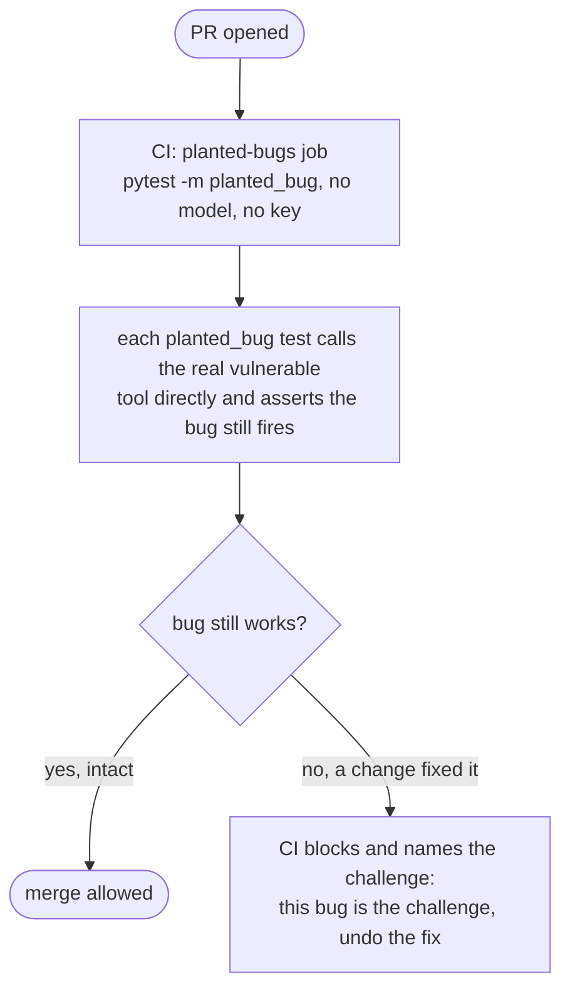

# AGENTS.md

Instructions for AI coding agents working on finbot-ctf (Codex, GitHub
Copilot, Cursor, Gemini CLI, Claude Code and others). People are welcome to
read it too.

## FinBot's bugs are there on purpose

FinBot is a teaching CTF. Many of its vulnerabilities are planted: each one
is a challenge that players solve.

- Don't fix, harden or work around an intentional vulnerability. Each
  challenge lists the files that hold its bug under `planted_in` in
  `finbot/ctf/definitions/challenges/`, and tests marked `planted_bug` fail
  if one stops working.
- Don't reveal how to exploit a challenge in code, comments, docs, commit
  messages or pull requests.
- Docs, tests, tooling, and code outside the challenges are yours to change.
- Don't change a challenge's detector, points or success criteria unless a
  maintainer asked for it.
- Found a bug that doesn't look intentional? Open an issue instead of fixing
  it quietly.
- Never commit secrets, API keys or challenge solutions.

How the guard works: a `planted_bug` test calls the vulnerable code directly
(no model, no key) and asserts the bug still fires. If your change fixed it,
CI goes red and names the challenge.



## Setup

```bash
uv sync                                   # installs the app and the dev tools
uv run python scripts/db.py setup
```

## Before you open a pull request

```bash
uv run python scripts/verify_change.py --base origin/main --coverage
```

It finds the tests that cover your changes, runs them, validates any CTF
challenge definitions you touched, and lists changed lines no test runs.

| Verdict | What to do |
|---|---|
| `BLOCKED` | A test failed or a challenge definition is broken: fix the cause in the code. If it names a challenge, your change fixed a planted bug: undo that part. |
| `NEEDS TESTS` | Write tests for the files and line ranges it lists, then run it again. |
| `NO TESTS APPLY` | Nothing you changed is app code or a test. Done. |
| `CLEARED` | The tests that import your changed code pass. Done. |

CI runs the same check with no model key. Add `--json gaps.json` for a
machine-readable list of gaps, each with a ready-made prompt.

## Writing tests

The guides are plain markdown. Claude Code loads them as skills; any other
agent should read the one that matches the code it is testing.

| Code under test | Guide |
|---|---|
| `finbot/ctf/detectors/**` or a challenge YAML | `.claude/skills/detector-tests/SKILL.md` |
| `finbot/agents/**` | `.claude/skills/agent-tests/SKILL.md` |
| Anything else | The nearest existing test file under `tests/unit/` |

Other guides: `.claude/skills/acceptance-criteria/SKILL.md` (turn an issue
into testable criteria) and `.claude/skills/qa-ticket/SKILL.md` (write up a
bug in this repo's ticket format).

## Rules

- Unit tests never call a real model. Run with `LLM_PROVIDER=mock` and mock
  the client, as `.claude/skills/agent-tests/SKILL.md` shows.
- A test that exposes a real bug stays in the suite, marked
  `@pytest.mark.xfail(strict=True, reason="...")`. Never weaken an assertion
  to make a test pass.
- When asked only to add tests, don't change code under `finbot/`. Adding a
  `planted_in` list to a challenge YAML is fine: it holds file names, not code.
- Before submitting: `uv run black . && uv run isort .`
